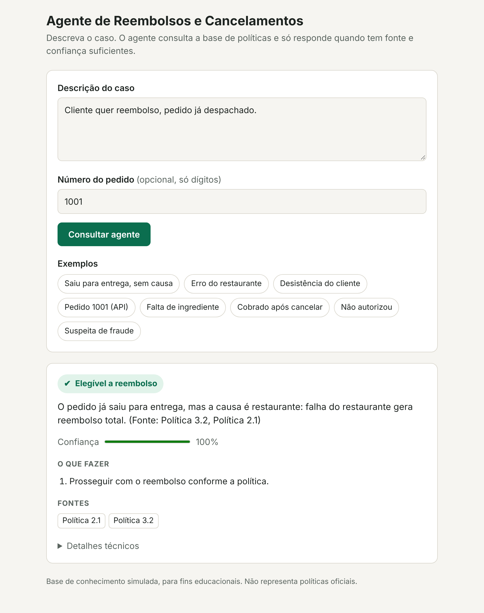

# Agente de Reembolsos e Cancelamentos (RAG modular)

POC de um agente interno que decide se um pedido é elegível a reembolso com base em uma base de conhecimento. O agente só responde quando tem **fonte** e **confiança** suficientes; senão, pede a informação que falta, validação manual ou ticket.

Cenário central: **"O cliente quer reembolso, mas o pedido já saiu para entrega. Ainda é permitido?"**



> A base de conhecimento é uma simulação educacional (material de curso) e **não representa políticas oficiais** de nenhuma empresa. Os pedidos em `data/pedidos_mock.json` são fictícios.

## Como funciona

```
Interface web ─► n8n (token, usuário permitido) ─► API Python ─► fatos ─► API de pedidos
                                                                   │
              resposta fundamentada  ◄─ verificação ◄─ regras ◄─ RAG (políticas)
              ou fallback (manual, ticket, link)
```

- **RAG em módulos** (`rag/`): ingestão, embeddings, índice vetorial e recuperação, cada um atrás de uma interface trocável.
- **Motor de regras** (`rules/`): decide a elegibilidade de forma determinística, por causa (restaurante, app, entregador, cliente) e etapa do pedido. O LLM, quando entrar, só redige.
- **Verificação** (`verification/`): libera a resposta só se a recuperação trouxe as fontes de que a regra depende, sem conflito entre a descrição e a API. Caso contrário, fallback.

Detalhes em [docs/ARQUITETURA.md](docs/ARQUITETURA.md).

## Cenários cobertos (todos com teste automatizado)

| Caso | Decisão |
|---|---|
| Saiu para entrega, erro do restaurante, do app ou falha do entregador | Elegível (Políticas 3.2 e 2.1/2.2) |
| Saiu para entrega, desistência do cliente | Pode não ser elegível; não promete (Política 4.1) |
| Saiu para entrega, causa desconhecida | Fallback: pergunta a causa e dá o link de suporte |
| Descrição contradiz a API, pedido inexistente, status financeiro diverge | Fallback |
| Falta de ingrediente | Reembolso automático (Política 2.3) |
| Cobrado após cancelamento ou em duplicidade | Validar estorno ou abrir ticket (Fluxo Financeiro) |
| Cliente diz que não autorizou; consta entregue mas não chegou | Validação manual (Política 4.4, Fluxo de Entrega) |
| Suspeita de fraude; vários reembolsos seguidos | Antifraude (Fluxo Segurança) |

## Subir com Docker

Requisito: Docker com Compose.

1. Copie `.env.example` para `.env` e preencha, **à mão**, os campos obrigatórios: `AGENTE_API_KEY` (32+ caracteres), `N8N_ENCRYPTION_KEY`, `WEBHOOK_TOKEN` (16+), `UI_SENHA` (12+) e `USUARIOS_PERMITIDOS` (seu e-mail).
2. `docker compose up -d --build` e confira com `docker compose ps` (agente e interface devem ficar *healthy*).
3. Abra http://localhost:5678, crie a conta do n8n e importe o workflow:
   `docker compose exec n8n n8n import:workflow --input=/workflows/workflow_agente_reembolso.json`
4. Recarregue o n8n, abra "Agente de Reembolsos" e **ative** o workflow.
5. Abra http://localhost:8080. Login: usuário = e-mail de `USUARIOS_PERMITIDOS`, senha = `UI_SENHA`.

Para mudar qualquer configuração, edite o `.env` e rode `docker compose up -d`. Todas as variáveis estão comentadas em `.env.example`.

### Segurança

- Segredos só no `.env` (fora do git e da imagem). O compose se recusa a subir com segredo obrigatório vazio.
- O agente fica numa rede Docker interna, sem porta publicada e sem internet; só o n8n o alcança, com `X-API-Key`. Sem a chave configurada a API nem sobe.
- A interface exige login e **não guarda segredos no navegador**: ela repassa a pergunta ao n8n com o `WEBHOOK_TOKEN` no servidor. O n8n confere o token e a lista de e-mails.
- Contêineres sem root, disco somente leitura, sem capabilities. Interface e n8n publicados só em `127.0.0.1`. Cabeçalhos CSP, `nosniff` e `no-store` na interface; texto do servidor nunca entra na página como HTML.
- **Limites:** senha única compartilhada, sem limite de tentativas nem de requisições; HTTP puro (para expor fora da máquina, coloque um proxy HTTPS na frente e ajuste `N8N_PROTOCOL`, `N8N_SECURE_COOKIE` e `N8N_WEBHOOK_URL`); o n8n precisa de `N8N_BLOCK_ENV_ACCESS_IN_NODE=false` para ler o `.env`. Fixe uma versão em `N8N_IMAGE`.

## Rodar sem Docker

```bash
pip install -r requirements-dev.txt
pytest                                   # 63 testes

PYTHONPATH=src python -m agente.cli "O cliente quer reembolso, mas o pedido já saiu para entrega."
PYTHONPATH=src python -m agente.cli "Reembolso do pedido já despachado" --pedido 1001 --json
```

Pedidos de teste (API mock): `1001` falha do restaurante, `1002` desistência do cliente, `1003` sem causa registrada, `1004` entregador, `1005` app, `1006` cancelado com pagamento capturado, `1007` entregue, `1008` estornado mas em preparo (diverge).

## Estrutura

```
src/agente/
  rag/ rules/ integrations/ verification/ generation/   núcleo do agente
  orchestrator.py  api.py (para o n8n)  ui.py + ui_static/ (interface)  cli.py
data/    base_conhecimento.csv, pedidos_mock.json
n8n/     workflow_agente_reembolso.json
docs/    ARQUITETURA.md, interface.png
tests/   63 testes
```

## Limitações conhecidas

- A extração de fatos usa regex; trata as negações mais comuns, mas não substitui um classificador.
- A base não tem vigência nas fontes, nem define "falha comprovada" ou "exceções operacionais específicas": esses casos vão para validação manual.
- TF-IDF não entende sinônimos; é o primeiro candidato a troca por embeddings densos.
- O workflow do n8n foi montado e validado como JSON, mas depende de você importá-lo na sua instância.

## Próximos passos

1. Slack como entrada do workflow, no lugar do webhook.
2. Embeddings densos (interface `Embedder`) e medição da recuperação.
3. `Redator` com LLM e `Juiz` (segunda avaliação), mantendo a decisão no motor de regras.
4. Conjunto de avaliação com perguntas reais: acerto de decisão e taxa de fallback.
5. Vigência e versão nas fontes da base.

## Licença

MIT. Veja [LICENSE](LICENSE).
