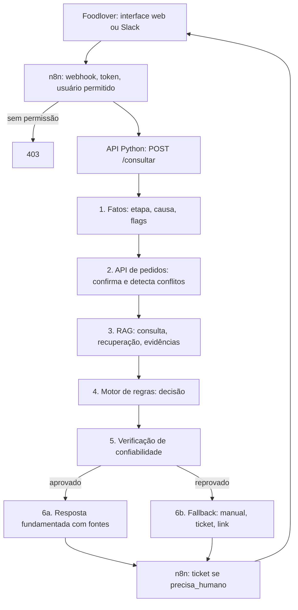

# Arquitetura

## Fluxo completo



## Pipeline RAG em módulos

| Etapa do RAG | Módulo | Padrão (POC) | Para escalar |
|---|---|---|---|
| Documentos da empresa | `data/base_conhecimento.csv` | CSV | PDFs, wiki, Confluence |
| Parsing e chunking | `rag/ingest.py` | 1 linha = 1 trecho | chunking por seção, metadados de vigência |
| Embeddings | `rag/embeddings.py` | TF-IDF offline | embeddings densos (interface `Embedder`) |
| Banco vetorial | `rag/store.py` | índice em memória | pgvector, Qdrant, OpenSearch |
| Recuperação | `rag/retriever.py`, `rag/consulta.py` | top-k + limite de score; consulta enriquecida pelos fatos | busca híbrida, reranker |
| LLM + contexto | `generation/redator.py`, `llm/redator.py` | template determinístico; LLM opcional (`LLM_PROVEDOR`) reescreve o `resumo` | outros provedores (interface `ClienteLLM`) |

## Quem decide o quê

- **O motor de regras** (`rules/engine.py`) decide a elegibilidade. É determinístico e cada regra declara de quais fontes depende.
- **O RAG** prova a decisão. A verificação só libera a resposta se a recuperação trouxe as fontes de que a regra depende (`fundamentada`).
- **O LLM, quando ligado,** só redige e, opcionalmente, revisa. Ele não decide e não pode liberar o que a verificação bloqueou. O redator recebe apenas o parecer e os trechos da base, nunca o texto do usuário, e a saída só vale se citar todas as fontes; senão vale o template.

## Verificação de confiabilidade (`verification/verificador.py`)

| Controle | Peso | Eliminatório | Falha quando |
|---|---|---|---|
| `fundamentada` | 0.25 | sim | a recuperação não trouxe todas as fontes da regra |
| `fatos_suficientes` | 0.20 | sim | falta informação (ex.: causa do problema) |
| `fontes_oficiais` | 0.15 | sim | a fonte não tem formato de política ou fluxo oficial |
| `sem_conflito` | 0.15 | sim | descrição e API divergem, ou há mais de uma causa |
| `recuperacao_forte` | 0.15 | não | similaridade abaixo de `SCORE_FORTE` |
| `causa_confirmada` | 0.10 | não | a causa veio só da descrição, sem confirmação da API |

Aprovado = nota ≥ 0.70 e nenhum eliminatório falhou. Quando um eliminatório falha, a nota é limitada a 0.69, para nunca contradizer o bloqueio. Um juiz com LLM opcional (`llm/juiz.py`, `LLM_JUIZ=true`) pode vetar depois dos controles determinísticos. Ele falha fechado: revisor fora do ar ou resposta fora do formato contam como veto.

## Decisões possíveis

`ELEGIVEL`, `PODE_NAO_ELEGIVEL` (desistência após a saída: nunca prometer), `VALIDACAO_MANUAL`, `ANTIFRAUDE`, `ORIENTACAO` (casos financeiros) e `FALLBACK`.

Prioridade das regras: fraude, exceções e casos financeiros, falta de item, regra geral por etapa e causa.

## Contrato da API

`POST /consultar` com `{ "pergunta": str, "pedido_id": "1001" (opcional), "usuario": str (opcional) }` devolve `decisao`, `resumo`, `passos`, `fontes`, `evidencias`, `confianca`, `precisa_humano`, `suporte_url`, `motivos_baixa_confianca`, `faltando` e `trace` (fatos, consulta, trechos recuperados, controles, latência).

## Implantação (docker-compose)

```
navegador --(login)--> ui :8080 (só 127.0.0.1)
                        |  guarda o WEBHOOK_TOKEN; o navegador nunca o vê
                        +--(X-Webhook-Token)--> n8n :5678 (só 127.0.0.1)
                                                 |  valida token e e-mail
                                                 +--(X-API-Key, rede interna)--> agente :8000 (sem porta publicada)
```

Todo valor que muda vem do `.env`: segredos, usuários permitidos, senha da interface, limiares de confiança, caminhos da base e versão da imagem do n8n.

## Limites conhecidos

- A base simulada não tem coluna de vigência. "Oficial" hoje é só o formato do nome da fonte.
- A extração de fatos usa regex: trata as negações mais comuns, mas não substitui um classificador.
- A base não define "falha comprovada" nem o que são "exceções operacionais específicas". O agente trata isso como caso para validação manual.
- Desistência do cliente antes da saída para entrega não está na base: cai em fallback.
- TF-IDF não entende sinônimos. É o primeiro candidato a troca quando a base crescer.
